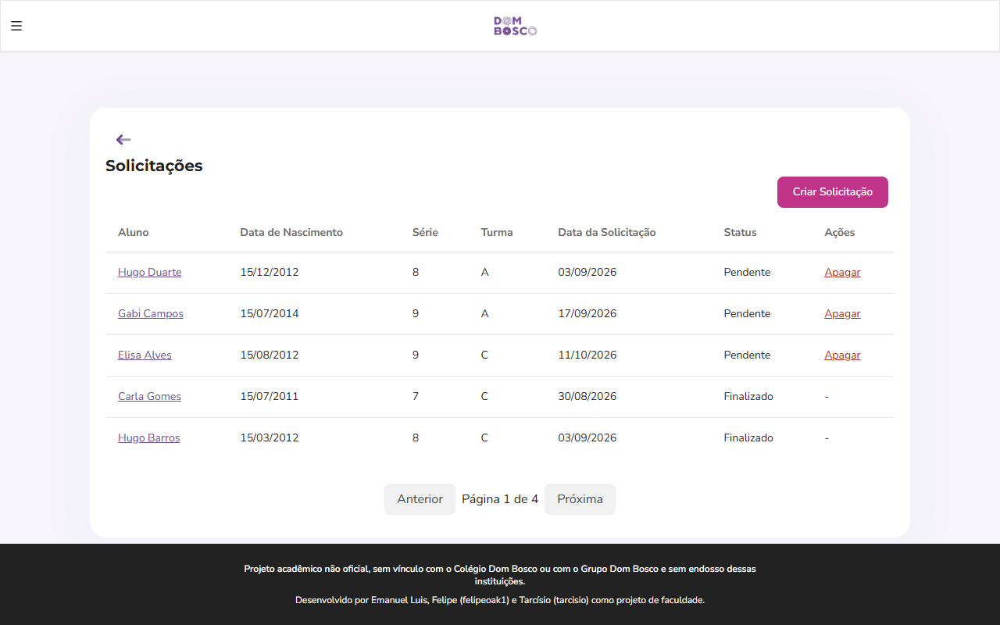
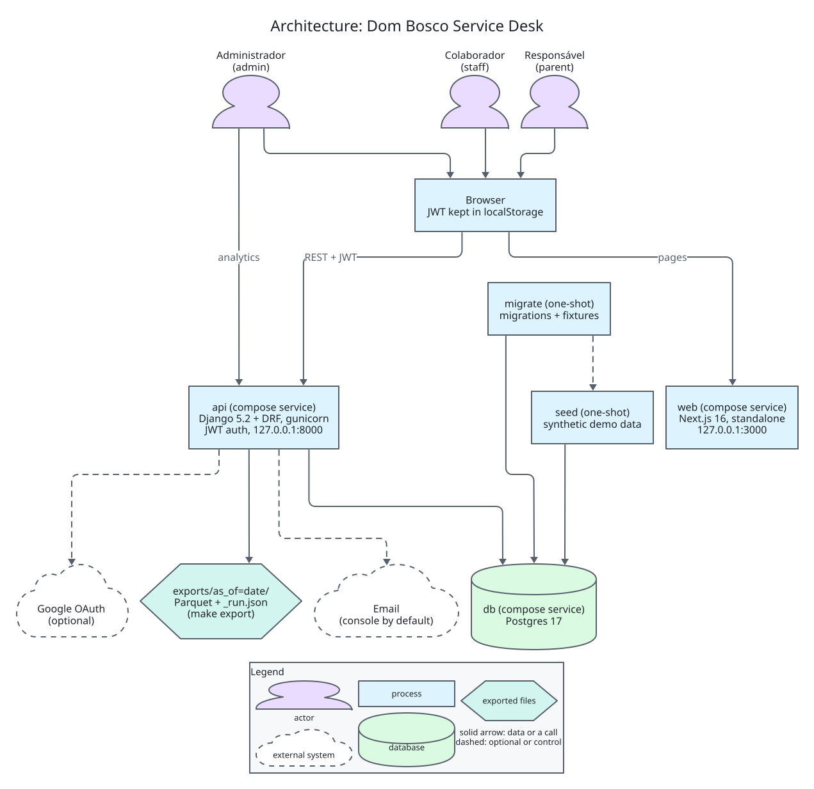
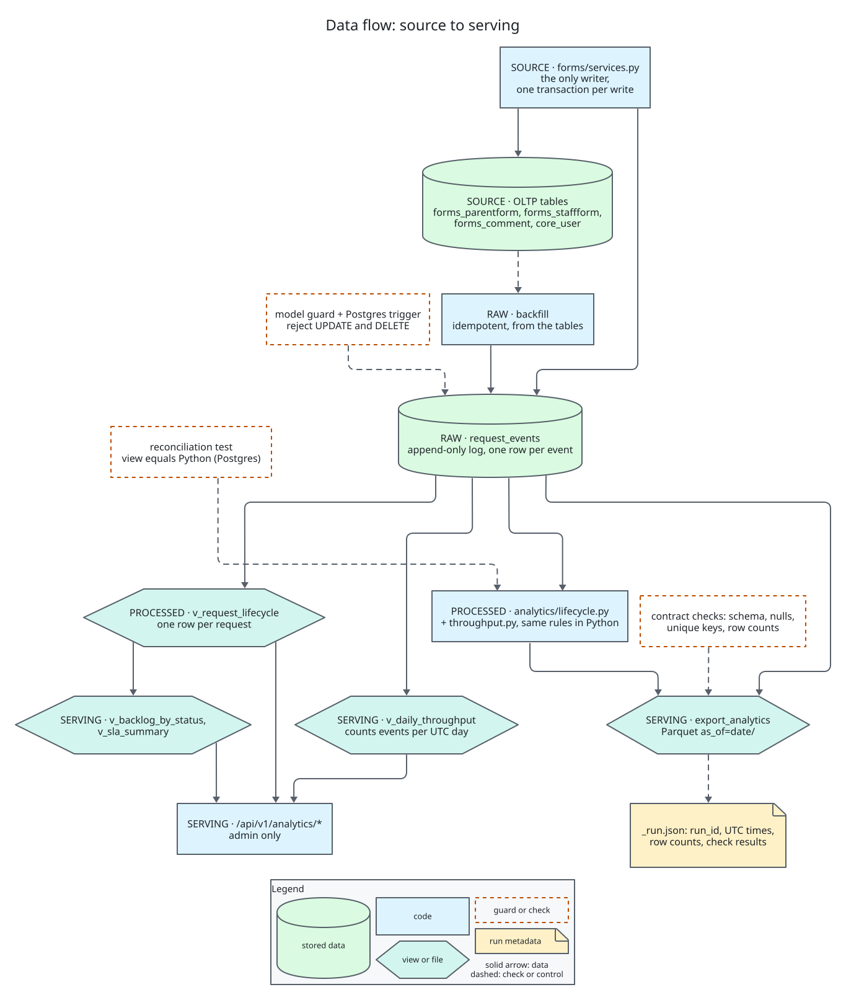
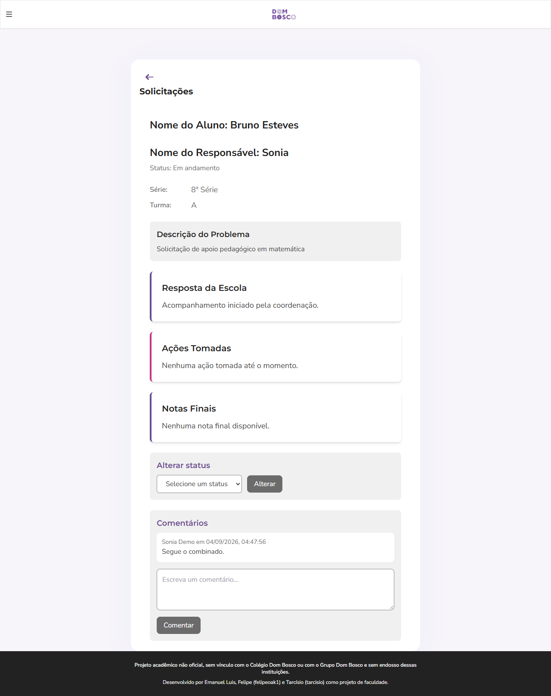
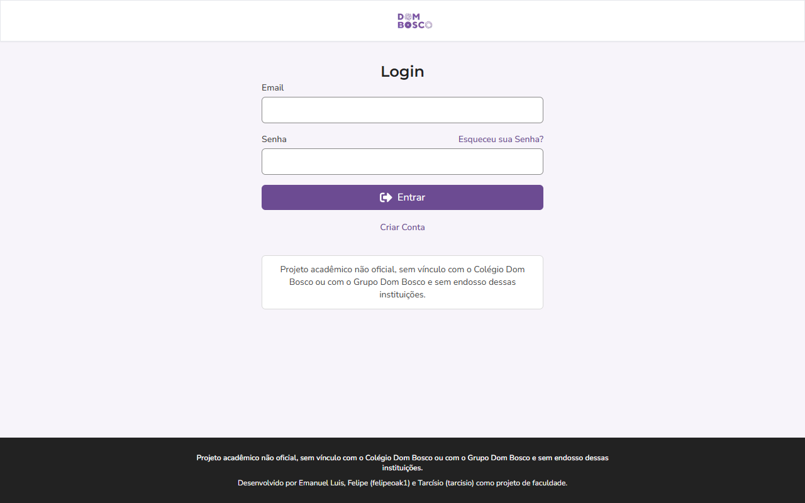
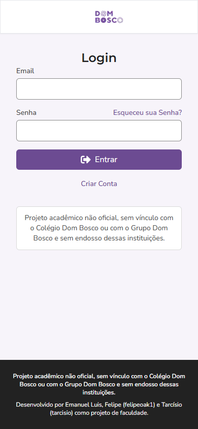

# Dom Bosco Service Desk

[](https://github.com/emanuel-luis/dombosco-service-desk/actions/workflows/ci.yml)
[](https://github.com/emanuel-luis/dombosco-service-desk/actions/workflows/security.yml)

A service desk for a school. Parents open requests about a student, school staff answer them, and both sides can comment on the thread. Administrators get lifecycle analytics: how long requests wait for a first response, how many are open per status, and how many are opened and closed per day.

> Unofficial academic project. Not affiliated with or endorsed by Colégio Dom Bosco or Grupo Dom Bosco.

The visual identity follows the school's public site (details in [docs/BRAND.md](docs/BRAND.md)).



## What this demonstrates

Data engineering:

- An append-only event log, `request_events`. Every service write inserts its event in the same transaction as the change. Updates and deletes are rejected twice: by the Django model and by a Postgres trigger. A backfill (migration plus management command) creates events for requests that predate the log and is safe to run again.
- Four named layers. Source: the OLTP tables written only through `forms/services.py`. Raw: `request_events`. Processed: the `v_request_lifecycle` view, one row per request, with the same rules implemented in pure Python (`analytics/lifecycle.py`) and a Postgres test that reconciles the two. Serving: the `v_daily_throughput`, `v_backlog_by_status` and `v_sla_summary` views, admin-only endpoints over them, and a Parquet export.
- The Parquet export has pyarrow schema contracts (exact columns, order, types, non-null keys), checks that run before anything is written, a rename-based partition swap that puts the previous partition back on failure, and a `_run.json` with run id, UTC timestamps and row counts.

Application engineering:

- A service layer where every request write goes through one transaction, with a permission matrix test per user group.
- Strict mypy on the backend, a typed TypeScript API client on the frontend, ruff, ESLint 9 and vitest.
- CI with a Postgres service, a compose smoke test that boots the whole stack and calls the API, and a security workflow (pip-audit, npm audit, zizmor) plus Dependabot.

## Architecture and data flow

[](docs/diagrams/architecture.d2)

Architecture of the stack. Source: [architecture.d2](docs/diagrams/architecture.d2).

[](docs/diagrams/data-flow.d2)

From OLTP tables to the serving layer. Source: [data-flow.d2](docs/diagrams/data-flow.d2).

More diagrams: [parent request flow](docs/diagrams/user-flows-parent-request.svg), [staff answer flow](docs/diagrams/user-flows-staff-answer.svg) and the [data model](docs/diagrams/data-model.svg).

Stack: Python 3.12, Django 5.2, Django REST Framework, drf-spectacular, simplejwt, dj-rest-auth and allauth (Google sign-in), PostgreSQL, pyarrow, Next.js 16, React 19, TypeScript, Tailwind, Docker Compose, GitHub Actions.

## Quickstart

Requirements: Docker, plus make, curl and python3 (Linux, macOS or WSL). In Git Bash, container paths need `MSYS_NO_PATHCONV=1`; the smoke script sets it.

```bash
make demo
```

This creates `.env` if it is missing (with a generated `SECRET_KEY`), builds the images, starts Postgres, runs migrations, loads synthetic demo data (about 60 requests over the last 60 days) and starts the API and the web app.

- Web: http://localhost:3000
- API docs: http://localhost:8000/swagger/

Demo logins, all at `@demo.example`: admin, staff1, staff2, parent1, parent2, parent3, user and visitor (for example `parent1@demo.example`). The password is `DEMO_PASSWORD` in `.env`, default `demo-only-change-me`. It is for the local demo only.

```bash
make smoke    # HTTP checks against the running stack
make export   # Parquet files for today (UTC) land in exports/as_of=<date>/
make down     # stop the stack and delete its volumes, demo data included
```

## Screenshots

All data is synthetic demo data from `make demo`.







## Development

Backend (uv, Python 3.12):

```bash
make install     # uv sync --locked --extra export
make lint        # ruff check, ruff format --check, mypy
make test-fast   # pytest on SQLite
```

`make test-fast` skips the Postgres-only tests (trigger and analytics views). They run in CI, or locally against any Postgres by setting `DATABASE_URL` before `uv run pytest` in `backend/`. Backend configuration comes from the environment; see `.env.example`.

Frontend (Node 24):

```bash
make frontend-install frontend-lint frontend-test frontend-build
```

Diagrams: `make d2-install` installs the pinned D2 (Linux, checksum verified), `make diagrams` renders the sources in `docs/diagrams/`, `make diagrams-check` fails when a committed SVG is stale (CI runs it), and `make diagrams-watch NAME=<diagram>` previews one live. See [docs/diagrams/README.md](docs/diagrams/README.md).

API docs: the OpenAPI schema is at `/swagger.json` and the Swagger UI at `/swagger/`. CI validates the schema.

## Analytics

Admin-only endpoints under `/api/v1/analytics/` (401 for anonymous callers, 403 for other groups):

- `requests/`: one row per request from `v_request_lifecycle`, paginated.
- `throughput/`: daily counts of opened, answered, finished and cancelled; optional `from` and `to` (YYYY-MM-DD, inclusive).
- `backlog/`: requests and oldest opening time per current status.
- `sla/`: p50 and p90 hours to first response and to close.

The views exist only on PostgreSQL; on other databases the endpoints answer 501.

Metric definitions:

- Opened is the earliest `request_created`. First response is the earlier of the first staff answer and the first comment by a staff member or administrator.
- A request is closed only when its current status is terminal (finished or cancelled). A request an administrator reopened has no close time.
- Throughput counts events, not requests, so a finish after a reopening counts again and deleted requests count.
- Backlog and SLA exclude deleted requests.

Export:

```bash
docker compose exec -T api python manage.py export_analytics --as-of 2026-10-28 --out /tmp/exports
```

`make export` runs this and copies the result out of the container. The snapshot holds every event before the end of the as-of day (UTC). It writes `request_events`, `request_lifecycle` and `daily_throughput` as Parquet plus `_run.json`. If a contract check fails, nothing is written and the previous partition stays as it was. Running again on unchanged data gives equal tables.

## Known limitations

- The JWT is stored in localStorage and there is no refresh-token flow.
- Signing up with Google at the staff email domain does not grant staff access. Only a confirmed email address does.
- Deleting a user in the Django admin cascades to their comments without writing `comment_deleted` events.

## History and credits

Built in 2024 as a college team project by Emanuel Luis, Felipe (felipeoak1) and Tarcísio (tarcisio). Refactored in 2026 into a maintained portfolio project. See the [CHANGELOG](CHANGELOG.md) and [docs/DECISIONS.md](docs/DECISIONS.md).

## License

[MIT](LICENSE), copyright held by the three authors: Emanuel Luis, Felipe (felipeoak1) and Tarcísio (tarcisio).
