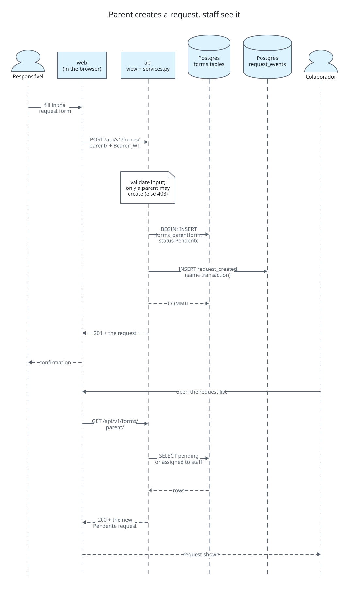
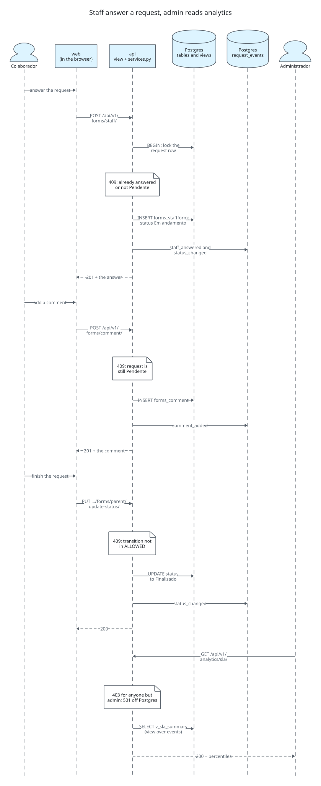
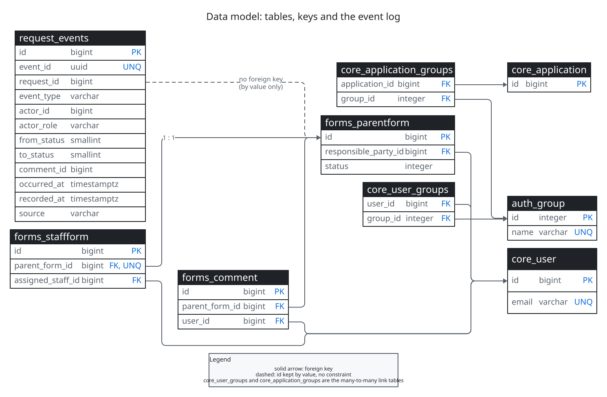

# Diagrams

Diagrams are code: each `<name>.d2` here is rendered to a committed `<name>.svg` with a pinned
[D2](https://d2lang.com) (v0.9.0, ELK layout, light and dark theme in one file). `_style.d2` holds
the shared fonts, colors and shapes. CI renders everything again and fails when a committed SVG is
stale.

## Make targets

Run them from the repository root, on Linux, macOS or WSL (the pinned D2 binary is Linux x86_64).

| Target | What it does |
| --- | --- |
| `make d2-install` | Downloads the pinned D2 into `~/.local/share/d2/v0.9.0`, checksum verified. Run once. |
| `make diagrams` | Renders every `docs/diagrams/*.d2` to SVG. Commit the result with the source. |
| `make diagrams-check` | Renders, then fails if an SVG differs from the committed one, is missing or has no source. This is the CI job `diagrams`. |
| `make diagrams-watch NAME=architecture` | Live preview in the browser while editing one diagram. |

Render through WSL or Linux only, so local and CI bytes match.

## The diagrams

Architecture: actors, browser and the compose services.

Source: [architecture.d2](architecture.d2).

Data flow: source, raw, processed and serving layers, with the checks and run metadata.

Source: [data-flow.d2](data-flow.d2).

User flow: a parent creates a request and staff see it.

Source: [user-flows-parent-request.d2](user-flows-parent-request.d2).

User flow: staff answer, comment and finish; an admin reads the analytics.

Source: [user-flows-staff-answer.d2](user-flows-staff-answer.d2).

Data model: tables, keys and the event log.

Source: [data-model.d2](data-model.d2).
